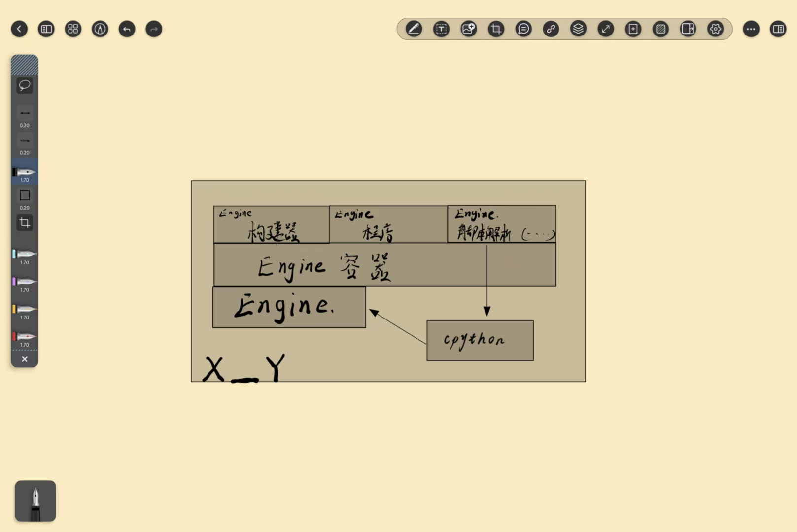

# X_Y

X_Y 是一个运行期引擎：`X_Y` 负责装载 DLL/SO、收集命令、执行命令和外部程序；
`pkg` 管已构建的包；`xy` 负责构建和从仓库安装。

> **这份 README 是当前实现的契约**：目录、命令、默认 root、ABI 以这里为准。
> 改代码必须同步改 README；“未完成 / 下一步”是规划，不算已实现。
> 版本：**1.1.0-dev**（基于 1.0.0，增加服务模块入口）。最后核对：2026-10-31。



> 代码地图见 [`_notes/KERNEL_MAP.md`](_notes/KERNEL_MAP.md)，
> Linux 验收清单见 [`_notes/LINUX_VERIFY.md`](_notes/LINUX_VERIFY.md)。

---

## 1. 用户使用目录

用户拿到的是**运行时包**，不需要源码、不需要构建器、不需要头文件。

### Windows

```
X_Y/
├─ bin/
│  ├─ X_Y.exe
│  ├─ pkg.dll
│  ├─ libstdc++-6.dll
│  ├─ libgcc_s_seh-1.dll
│  └─ libwinpthread-1.dll
│
├─ modules/
│  └─ HelloXy/
│     └─ 0.1.0/
│        ├─ package.xy
│        └─ HelloXy.dll
│
└─ README.md
```

### Linux

```
X_Y/
├─ bin/
│  ├─ X_Y
│  └─ pkg.so
│
├─ modules/
│  └─ HelloXy/
│     └─ 0.1.0/
│        ├─ package.xy
│        └─ HelloXy.so
│
└─ README.md
```

### 约定

- `X_Y` 和 `pkg` 永远在 `bin/` 同目录。
- 所有可加载的包/模块都在 `modules/<name>/<version>/`。
- `pkg` 默认 root 是 `bin/../modules`；`X_Y` 启动时会把 `XY_MODULES` 设成这个路径。
- 用户包里没有 `xy`、`include/`、`cache/`、`repo/`、源码。
- Windows 运行库放在 `bin/`，Linux 用系统的 `libstdc++`。

### 用户命令

```
X_Y                                  交互 shell
X_Y --run abi                        执行一条命令
X_Y --module bin/pkg.dll             启动时装载 pkg
X_Y --program modules/HelloXy/0.1.0/HelloXy.dll a b
```

shell 里：

```
> load pkg.dll
> pkg list
> pkg install /path/to/package-dir
> load HelloXy.dll
> run HelloXy a b
```

---

## 2. 开发使用目录

开发包才有源码、构建器、头文件和缓存。

```
X_Y/
├─ CMakeLists.txt               # 内核 + Apps + Programs + Builder
├─ README.md
├─ X_Y设计图.jpg
├─ .gitignore
│
├─ Engine/                      # 内核源码
│  ├─ include/
│  │  ├─ xy_api.h               # ABI：版本 / host 表 / program 入口
│  │  └─ xy_command.h           # 命令形状 / commands 入口
│  └─ src/
│     ├─ main.cpp               # 启动、参数、模式
│     ├─ Host.h / Host.cpp      # EngineContext + host 回调
│     ├─ Services.h / .cpp      # 名字 → 指针 + owner
│     ├─ CommandTable.h / .cpp  # 命令名 → XyCommandV1* + owner
│     ├─ ModuleRegistry.h/.cpp  # DLL 装载 / ABI 检查 / 卸载
│     ├─ KernelCommands.h/.cpp  # 内建命令
│     ├─ Shell.h / Shell.cpp    # 分词 / run 分发 / 交互循环
│     └─ Platform/
│        ├─ Library.h           # LoadLibrary / dlopen 接口
│        ├─ Process.h           # CreateProcess / fork 接口
│        ├─ Win32/
│        │  ├─ LibraryWin32.cpp
│        │  └─ ProcessWin32.cpp
│        └─ Posix/
│           ├─ LibraryPosix.cpp
│           └─ ProcessPosix.cpp
│
├─ Apps/
│  └─ Pkg/                      # 包管理命令 DLL
│     ├─ CMakeLists.txt
│     └─ src/main.cpp
│
├─ Builder/                     # xy.exe：构建 + 仓库安装
│  ├─ CMakeLists.txt
│  └─ src/main.cpp
│
├─ Programs/
│  └─ HelloXy/                  # 最小微程序
│     ├─ CMakeLists.txt
│     ├─ package.xy
│     └─ src/main.cpp
│
├─ _notes/                      # 不纳入版本控制
│  ├─ KERNEL_MAP.md
│  ├─ LINUX_VERIFY.md
│  └─ REFACTOR_PLAN.md
│
├─ build/                       # 构建树（不进版本控制）
│  └─ out/
│     ├─ bin/                   # X_Y、xy、pkg、HelloXy（当前构建产物）
│     ├─ lib/                   # .a / .lib / import lib
│     └─ modules/               # pkg install 的安装目标
│
├─ .cache/                      # xy build 的临时产物（不进版本控制）
│  └─ out/
│
└─ repo/                        # 可选：本地包仓库
   └─ HelloXy/0.1.0/...
```

### 构建目录 vs 发布目录

| 开发构建 | 发布/用户 |
|---|---|
| `build/out/bin/` | `bin/` |
| `build/out/modules/` | `modules/` |
| `build/out/lib/` | 不发布（只放编译期库） |
| `.cache/` | 不发布 |
| `_notes/`、`Engine/`、`Apps/`、`Builder/` | 不发布 |

Windows 的 `.dll`、Linux 的 `.so` 都在 `out/bin`；`out/lib` 只放静态库/import lib。

---

## 3. 文件职责

| 文件 | 负责 |
|---|---|
| `Engine/include/xy_api.h` | ABI 底座：版本、导出宏、host 表、program 入口 |
| `Engine/include/xy_command.h` | 命令形状、commands 入口 |
| `Engine/src/Host.*` | `EngineContext`、alloc/free/log/service 回调 |
| `Engine/src/Services.*` | 名字 → 指针 + owner |
| `Engine/src/CommandTable.*` | 命令名 → 命令对象 + owner |
| `Engine/src/ModuleRegistry.*` | DLL 装载/卸载、ABI 检查、命令登记 |
| `Engine/src/KernelCommands.*` | `help/commands/modules/load/unload/program/exec/mem/abi` |
| `Engine/src/Shell.*` | 分词、`run` 前缀、查表、owner、交互循环 |
| `Engine/src/main.cpp` | 参数、启动、模式选择 |
| `Engine/src/Platform/*` | 动态库和外部进程的平台差异 |
| `Apps/Pkg` | `pkg list/info/verify/install/remove` |
| `Builder` | `xy build/install/doctor` |
| `Programs/HelloXy` | 只认 `xy_api.h` 的最小微程序 |
| `CMakeLists.txt` | 目标、输出目录、Memory 链接、程序/应用接入 |

---

## 4. 构建

### 前置

- C++20 编译器（MinGW g++ 13 / Linux g++）
- CMake >= 3.24
- Ninja 或 Make
- `Modules/` 里先编出 `libMemory.a`

### Linux

```bash
cd /path/to/workbench

cmake -S Modules -B Modules/build-linux -G Ninja \
  -DCMAKE_BUILD_TYPE=Debug \
  -DXY_MODULES=Memory
cmake --build Modules/build-linux --target Memory

cmake -S X_Y -B X_Y/build-linux -G Ninja \
  -DCMAKE_BUILD_TYPE=Debug \
  -DXY_MEMORY_LIB="$PWD/Modules/build-linux/out/lib/libMemory.a"
cmake --build X_Y/build-linux
```

产物：

```
X_Y/build-linux/out/bin/X_Y
X_Y/build-linux/out/bin/xy
X_Y/build-linux/out/bin/pkg.so
X_Y/build-linux/out/bin/HelloXy.so
```

### Windows（MinGW Makefiles）

```powershell
$env:PATH = "D:\QT\Tools\mingw1310_64\bin;" + $env:PATH

cmake -S X_Y -B X_Y/build -G "MinGW Makefiles" `
  -DCMAKE_BUILD_TYPE=Debug `
  -DCMAKE_CXX_COMPILER="D:/QT/Tools/mingw1310_64/bin/g++.exe" `
  -DCMAKE_MAKE_PROGRAM="D:/QT/Tools/mingw1310_64/bin/mingw32-make.exe"

cmake --build X_Y/build
```

> 这台机器上 Ninja 的 `try_compile` / glob recheck 会卡，Windows 构建固定用 MinGW Makefiles。

---

## 5. pkg

`pkg` 是命令 DLL，管理 `modules/`。

```
pkg list   [root] [--repo <dir>]
pkg info   <name> [root] [--repo <dir>]
pkg verify [root] [--repo <dir>]
pkg install <源目录> [--root <dir>] [--force]
pkg remove  <name> [version] [--root <dir>] [--all]
```

默认 root 顺序：

1. 命令行 `--root` / 位置参数
2. 环境变量 `XY_MODULES`
3. `./Modules`

`X_Y` 启动时会把 `XY_MODULES` 设成 `bin/../modules`，所以正常运行时不用手写 root。

manifest：

```
name    = HelloXy
version = 0.1.0
kind    = program
abi     = 1
entry   = xy_program_v1
file    = HelloXy.dll
source  = src
```

安装布局：

```
modules/<name>/<version>/
  package.xy
  <包内文件>
```

---

## 6. xy

`xy` 是构建期工具，不进用户包。

```
xy build   <源目录> [--out <目录>] [--include <Engine/include>] [--cxx <编译器>]
xy install <name> [version] [--repo <仓库>] [--root <安装根>]
           [--build] [--force] [--include ...] [--cxx ...]
           [--x-y <X_Y>] [--pkg <pkg>]
xy doctor  [--repo <仓库>] [--include ...] [--cxx ...]
```

### 仓库

```
<repo>/
  HelloXy/
    0.1.0/
      package.xy
      HelloXy.dll      # 二进制包
      src/...          # 源码包（可选）
```

- `file` 存在 → 二进制包
- `source` 目录存在 → 源码包
- 版本省略 → 选最高版本
- 有二进制默认用二进制；`--build` 强制源码

### 流程

```
xy install HelloXy 0.1.0 --repo repo/
  ├─ 在 repo 找包
  ├─ 有二进制 -> X_Y --module pkg --run pkg install <包目录>
  └─ 只有源码 / --build -> xy build -> pkg install
```

`xy` 自己不写 `modules/`，收包始终由 `pkg` 做。
`--root` 默认 `bin/../modules`，和 `pkg` 的默认 root 一致。

### 自检

```
xy doctor --repo ../Modules
```

检查：编译器、Engine include、X_Y、pkg、repo。

---

## 7. 扩展与 ABI

普通扩展只 include：

```cpp
#include <xy_api.h>
#include <xy_command.h>
```

入口：

| 导出 | 用途 |
|---|---|
| `xy_abi_version_v1` | 必须导出，返回 `XY_ABI_VERSION` |
| `xy_program_v1` | 微程序入口 |
| `xy_commands_v1` | 命令表入口 |
| `xy_module_v1` | 可选：模块初始化，注册服务 |
| `xy_module_shutdown_v1` | 可选：卸载前反注册服务 |

加载顺序：验 ABI → `xy_module_v1(host)` → `xy_commands_v1(host)` → 登记命令。
卸载顺序：`xy_module_shutdown_v1()` → 摘命令 → 摘服务 → `FreeLibrary`。

规则：

- 跨 DLL 只传 C 类型；不传 `std::string` / 容器 / 异常
- 结构体只尾部追加；用 `size` 判断字段
- `host->alloc` 的指针只能 `host->free`
- 命令表、命令对象归 DLL 所有，卸载前必须有效
- 一次性 program 禁止 `add_service`
- 服务在 `xy_module_v1` 注册，`xy_module_shutdown_v1` 反注册；漏掉的由内核按 owner 清理并报泄漏

`XyHostV1` 是内核给扩展的能力表；它只放 alloc/free/log/service。
网络、文件这类能力以后通过 **服务对象**（每个 engine 自己的 host + C 函数表）注入，
不往全局 host 上堆。

---

## 8. 当前状态

v1.1.0-dev 已完成：

- ABI 头、host、services、command table
- 服务模块入口：`xy_module_v1` / `xy_module_shutdown_v1`
- DLL 装载/卸载、微程序包装、命令 owner
- 内建命令、shell、main
- Windows 平台 Library / Process 实测
- Linux 真机验收（用户确认已跑；验收输出未留档）
- `pkg` v1：list / info / verify / install / remove
- `xy` v1：build / install / doctor，仓库按 name/version 安装
- 固定运行目录：`out/bin` + `out/modules`，`X_Y` 自动设置 `XY_MODULES`

未完成 / 下一步：

- Engine 容器、per-engine host、服务对象 ABI（`net_api.h` 这类）
- `provides` / `requires` 依赖顺序
- `pkg` 联网下载（HTTP + 索引 + 校验）
- 多线程策略（放 Modules，内核 v2 接入）
- `xy doctor` 对 DLL 导出表的检查

---

## 9. README 维护规矩

- 改目录布局、默认 root、命令参数、ABI 字段：**同一次改动里更新本文件**。
- 新功能先加到“已完成”，不要只留在 `_notes`。
- “未完成 / 下一步”只是方向，不当作已经存在的能力。
- 如果代码和本文件冲突，以本文件为准，先改代码或先改文件，不能两边各说各的。
