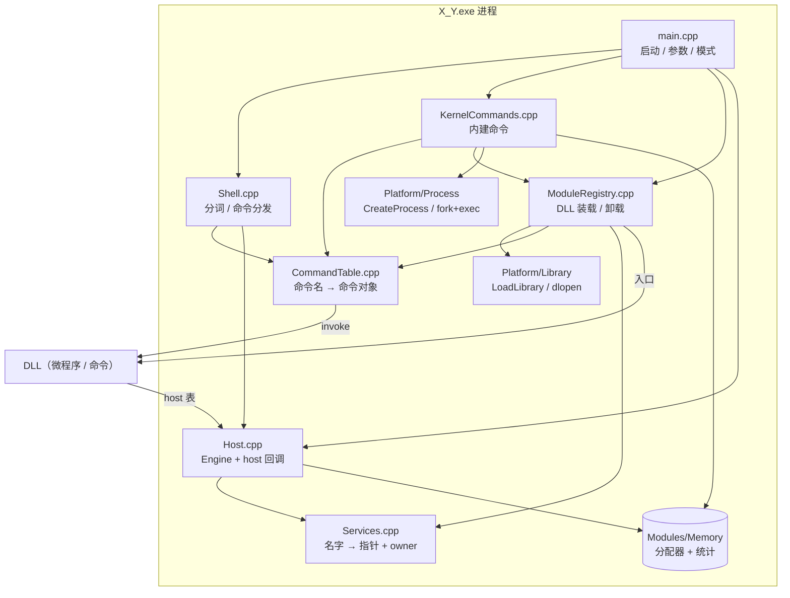
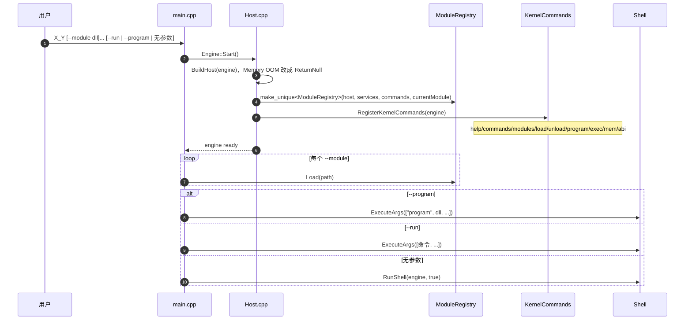
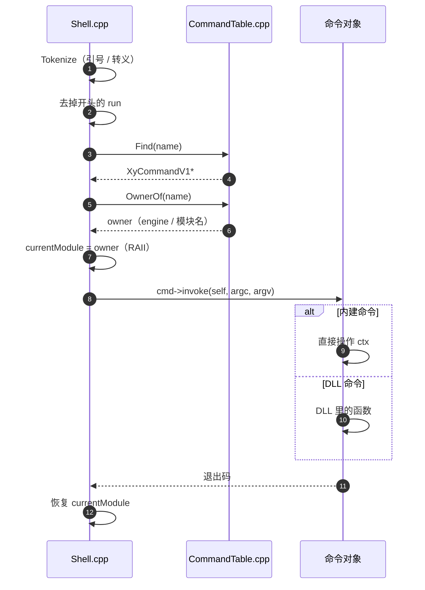
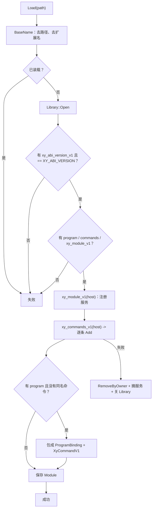
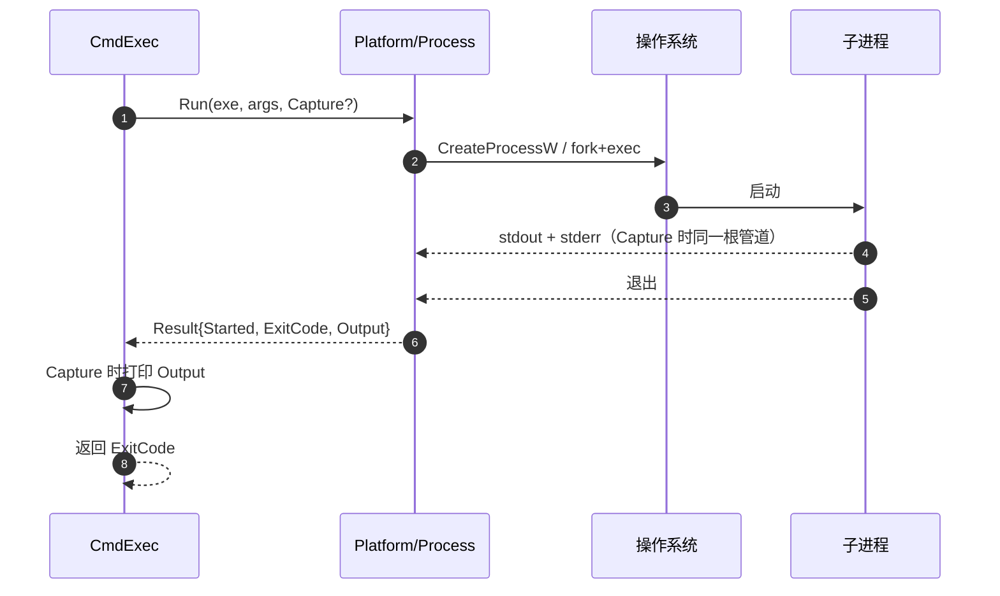

# X_Y 内核代码地图

> 目的：看清每个文件负责什么、谁调用谁、一次启动/一条命令/DLL 装载分别怎么走。
> 当前是 **v1 单线程**；`pkg`、`xy build/module/install/doctor` 都已进来。

---

## 0. 一句话总览

`X_Y.exe` 是宿主：它**装载 DLL、收集命令、读命令行、分发调用**。
DLL 不链接内核内部符号，只通过 `xy_api.h` 拿一张 **host 表**；
外部 exe 不装进进程，只通过 `Platform/Process` 拉起、收输出。

```
用户
  │
  ▼
main.cpp ──► Host / ModuleRegistry / KernelCommands / Shell
  │                 │              │
  │                 │              ├─► CommandTable
  │                 │              ├─► Platform/Process（外部 exe）
  │                 │              └─► Platform/Library（DLL）
  │                 └─► Modules/Memory（alloc/free）
  │
  └─► 加载的 DLL：HelloXy.dll / pkg.dll / ...
        └─ 通过 host 回调内核；导出 xy_program_v1 / xy_commands_v1
```

---

## 0.1 固定运行目录

Windows / Linux 同一套，只差后缀：

```
out/
├─ bin/        X_Y、xy、pkg、HelloXy（所有能跑/能加载的）
├─ modules/    pkg install / xy install 的默认安装目标
└─ lib/        只放 .a / .lib / import lib
```

- `xy` 和 `pkg` 永远在 `bin/` 同目录。
- `X_Y` 启动时把 `XY_MODULES` 设成 `bin/../modules`，`pkg` 默认用它。
- `xy install` 默认 root 也是 `bin/../modules`。
- 发布时 `bin/` + `modules/` 就是用户包；`xy`、`include/`、`cache/` 只进开发包。

---

## 1. 分层图



ASCII 版：

```
┌──────────────────────────── X_Y.exe 进程 ────────────────────────────┐
│                                                                      │
│  main.cpp                                                            │
│    ├─ Host.cpp / Engine ── Services.cpp                       │
│    ├─ ModuleRegistry.cpp ── Platform/Library ── LoadLibrary/dlopen   │
│    ├─ KernelCommands.cpp ── CommandTable.cpp                         │
│    │                    ├─ Platform/Process ── CreateProcess/fork    │
│    │                    └─ ModuleRegistry                            │
│    └─ Shell.cpp ── CommandTable                                      │
│                                                                      │
│  Host.cpp ── Modules/Memory（alloc/free）                            │
│                                                                      │
│  加载的 DLL：HelloXy.dll / pkg.dll ...                               │
│    └─ 通过 host 回调内核；导出 xy_program_v1 / xy_commands_v1        │
└──────────────────────────────────────────────────────────────────────┘
```

---

## 2. 启动流程



关键点：

- `--help` / `--version` 在 `Engine::Start()` 之前就返回。
- `MarkBaseline` 在 `Engine::Start()` 里 `BuildHost` 之后、`ModuleRegistry` / `RegisterKernelCommands` 之前，
  所以 `mem` 的门面数字从“命令表建好”开始算。
- `ModuleRegistry` 归 `Engine` 所有；`engine.modules` 在 `RegisterKernelCommands` 之前建好，内建命令才能用。

---

## 3. 一条命令怎么走



`self` 的三种来源：

| 命令来源 | `self` 指向 | 谁持有 |
|---|---|---|
| 内建命令 | `Engine` | 内核静态对象 |
| DLL 命令表 | DLL 自己决定，可为 NULL | DLL |
| 微程序包装命令 | `ProgramBinding` | `ModuleRegistry::Module` |

---

## 4. DLL 装载 / 卸载



卸载顺序不能反：

```
1. xy_module_shutdown_v1()              先让 provider 反注册
2. CommandTable::RemoveByOwner(owner)   再摘命令，避免悬垂
3. Services::Remove(owner 名下)         最后摘服务，剩下记泄漏
4. Module 析构                           FreeLibrary
```

---

## 4.1 服务查找层级

```
所有 Engine: services.Get(name)
  ├─ 本地有 -> 返回
  └─ 本地没有 -> container.shared.Get(name)

子 Engine:
  └─ shared 也没有 -> root.services.Get(name)

root: 只查自己 + shared，不反向看子 Engine
兄弟 Engine: 私有服务不互相看，只通过 shared 共享
```

- `engine share <engine> <service>` 把 provider 的本地服务指针放进 `container.shared`。
- `sharedProviders_` 记录 service → provider engine；provider 被共享期间不能 `engine destroy`。
- root 有共享服务时，`unload` 会被拒绝，必须先 `engine unshare`。
- 共享阶段还没有引用计数；拿到指针的一方和 provider 的生命周期由命令层保证。

命令查找同样层级：

```
Engine.commands
  -> container.sharedCommands
  -> root.commands（子 Engine）
```

- `engine share-command <engine> <command>` / `unshare-command`
- `sharedCommandProviders_` 记录 command → provider engine
- provider 还有共享命令时不能销毁/卸载

---

## 5. 外部进程



- 外部 exe **没有 host**，不共享地址空间。
- v1 合并捕获 stdout/stderr，不开线程。
- `--capture` 只是把输出读回来打印；不是管道/重定向。

---

## 6. 文件职责表

| 文件 | 负责什么 | 依赖 |
|---|---|---|
| `Engine/include/xy_api.h` | ABI 底座：版本、导出宏、host 表、program 入口 | 无 |
| `Engine/include/xy_command.h` | 命令形状、命令表入口 | `xy_api.h` |
| `Engine/include/xy_kernel.h` | `kernel` 服务：命令分发 C 入口 | `xy_api.h` |
| `Engine/src/Host.h` | `Engine`：services / commands / modules / currentModule / host | Services、CommandTable、ModuleRegistry、xy_api |
| `Engine/src/Host.cpp` | `Engine::Start()` + host 六个回调 | ModuleRegistry、KernelCommands、Memory、Services |
| `Engine/src/EngineContainer.h/.cpp` | 单线程容器：create/list/destroy/load/unload/run/services/shared/share/unshare，shared 服务表 | Host、Services |
| `test/container_smoke.*` | 容器冒烟测试：echo fixture、共享、unload/destroy 拦截 | X_Y、gcc |
| `Engine/src/Services.h/.cpp` | 名字 → 指针 + owner | 无 |
| `Engine/src/CommandTable.h/.cpp` | 命令名 → `XyCommandV1*` + owner | xy_command |
| `Engine/src/ModuleRegistry.h/.cpp` | DLL 生命周期、ABI 检查、命令登记、微程序包装 | Library、Services、CommandTable、xy_api/command |
| `Engine/src/KernelCommands.h/.cpp` | 内建命令：help/commands/modules/engine/load/unload/program/exec/mem/abi | Host、ModuleRegistry、EngineContainer、CommandTable、Library、Process、Memory |
| `Engine/src/Shell.h/.cpp` | 分词、`run` 前缀、查表、owner 设置、交互循环 | Host、CommandTable |
| `Engine/src/Platform/Library.h` | 动态库打开/找符号/关闭的接口 | 无平台头 |
| `Engine/src/Platform/Win32/LibraryWin32.cpp` | `LoadLibraryW` / `GetProcAddress` / `FreeLibrary` | windows.h |
| `Engine/src/Platform/Posix/LibraryPosix.cpp` | `dlopen` / `dlsym` / `dlclose` | dlfcn.h |
| `Engine/src/Platform/Process.h` | 外部进程接口 + 结果 | 无平台头 |
| `Engine/src/Platform/Win32/ProcessWin32.cpp` | `CreateProcessW` + 合并管道 | windows.h |
| `Engine/src/Platform/Posix/ProcessPosix.cpp` | `fork` + `execvp` + 合并管道 | unistd.h / sys/wait.h |
| `Engine/src/main.cpp` | 参数解析、模式选择、`Engine::Start()` | 以上所有 |
| `Programs/HelloXy/*` | 最小微程序，只认 xy_api | xy_api |
| `Plugins/Shell/*` | Modules Shell + kernel fallback，`xy_program_v1` 插件 | Terminal、xy_kernel |
| `Modules/IO/src/FilesCore.cpp` | IO.dll 的跨平台整文件/目录实现（Modules 侧） | IO::Files |
| `Apps/Pkg/*` | 包管理命令 DLL：扫描 manifest、install/remove | xy_api、xy_command、std::filesystem |
| `Builder/*` | `xy build/module/install/doctor/env`：编译、模块依赖、仓库解析、环境自检 | Platform/Process、std::filesystem |
| `CMakeLists.txt` | 目标、Memory 共享库、import lib、平台过滤、Programs 接入 | — |

---

## 7. 依赖方向

只允许单向，避免循环：

```
xy_api.h
  └─ xy_command.h
       ├─ CommandTable
       ├─ Services
       └─ Host
            ├─ ModuleRegistry
            │    └─ Platform/Library
            ├─ KernelCommands
            │    ├─ ModuleRegistry
            │    ├─ Platform/Process
            │    └─ Memory
            └─ Shell
main
  ├─ EngineContainer ── Engine（Host → ModuleRegistry）
  └─ KernelCommands / Shell
```

调用矩阵：

| 谁 \ 调谁 | Host | Services | CommandTable | ModuleRegistry | KernelCommands | Shell | Library | Process |
|---|---|---|---|---|---|---|---|---|
| main | ✅ |  |  | ✅ | ✅ | ✅ |  |  |
| Shell | ✅ |  | ✅ |  |  |  |  |  |
| KernelCommands | ✅ |  | ✅ | ✅ |  |  | ✅ | ✅ |
| ModuleRegistry |  | ✅ | ✅ |  |  |  | ✅ |  |
| Host |  | ✅ |  |  |  |  |  |  |

---

## 8. 当前状态 / 下一步

已完成：

- ABI 头、host、services、command table
- Engine 实例化：每个 Engine 一份 host / services / commands，`ModuleRegistry` 也归 Engine 所有（`Start()` 建）
- EngineContainer：单线程 `engine create/list/destroy/load/unload/run/services/shared/share/unshare/share-command/unshare-command/shared-commands` 子 Engine
- 容器共享服务：`share` / `unshare`，provider 共享期间禁止销毁/卸载
- 容器冒烟测试：`test/container_smoke.ps1` / `container_smoke.sh`
- Memory 共享库：`Memory.dll` / `libMemory.so`，显式 `X_Y::New/Delete/Malloc/Free/Buffer`
- Memory 依赖包：`out/modules/Memory/{include,bin,lib,package.xy}`
- IO 第三方 C++ 库：`out/modules/IO/{include,bin,lib,package.xy}`，链 IO + Memory
- `xy module`：读 Modules 侧 `module.xy`，递归依赖，输出到 `out/modules`
- `xy install <name>`：有 `module.xy` 时直接走模块构建，否则走包仓库
- `enve.json`：root = out，bin/modules/lib/temp/source 统一解析；`xy env` 打印
- `xy` 把 `TMP` / `TEMP` / `TMPDIR` 指到 `.cache/tmp`，编译临时文件不落系统 TEMP
- `pkg` 接受 `kind = library`
- 跨 engine 服务查找：本地 → container.shared → root（子 Engine）
- 跨 engine 命令查找：本地 → container.shared → root（子 Engine）
- 服务模块入口：`xy_module_v1` / `xy_module_shutdown_v1`
- `kernel` 服务：每个 Engine 一份 `XyKernelV1`，命令分发 local→shared→root
- Shell 插件：`Plugins/Shell/0.1.0`，`xy install Shell --repo Plugins --build`
- `deps` 自动 include/link，支持 `:static` / `:shared`；`libs` 只做作者自己的裸 `-l`
- Modules `Command::Registry::SetFallback` 可把未知命令交回 `kernel->run`
- DLL 装载/卸载、微程序包装、命令 owner
- 内建命令、shell、main
- 平台 Library / Process（Windows 实测；Linux 用户确认已跑）
- `HelloXy` 两条路：`--program` 与 `--module` + `--run HelloXy`
- `pkg` v1：list / info / verify / install / remove，本地布局 `<root>/<name>/<version>/`
- `xy build`：`Programs/HelloXy` → `.cache/out` → `pkg install` → `X_Y --program` 闭环
- `xy module`：Memory → IO 依赖链 → `out/modules`
- `xy install <name> [version] --repo`：仓库找包；二进制直接装，源码先构建再装
- `xy doctor`：编译器 / Engine include / X_Y / pkg / repo 自检

未完成：

- 懒启动 / 服务引用计数 / 线程
- 更多服务对象 ABI（`net_api.h` 等）与 `provides` / `requires`
- `pkg load` / 远程下载 / 依赖求解
- `exec` 分开 stdout/stderr、流式输出、超时
- shell 的 tty 判断（现在管道里也会打 `> `）
- host 文件服务
- Thread 模块与内核 v2（多线程模型）

---

## 9. 关键不变量

1. `xy_api.h` / `xy_command.h` 只出现 C 类型，不出现 STL / 平台头。
2. `currentModule` 是 owner 的唯一来源；Shell / ModuleRegistry 用 RAII 设置并恢复。
3. `CommandTable` / `Services` 只存指针，不拥有对象；卸载前必须先摘表。
4. Memory 全进程一份：`Memory.dll` / `libMemory.so` 是独立共享库；X_Y、IO、consumer 都链它的 import lib，不再 whole-archive 进 exe。
5. 一次性 `program` 期间 `oneShot=true`，`add_service` 直接拒绝。
6. v1 单线程：`Services` / `CommandTable` 不加锁；worker 线程留给 v2。
7. 外部 exe 没有 host；DLL 才有 host。

---

## 10. 一张 ASCII 总图

```
【启动】
main
 ├─ BuildHost(ctx)                    填 XyHostV1
 ├─ ModuleRegistry(host, services, commands, currentModule)
 ├─ RegisterKernelCommands(ctx)       help/commands/load/... 进 CommandTable
 ├─ for --module: registry.Load(path)
 └─ 选模式
      ├─ --program  -> ExecuteArgs(["program", dll, ...])
      ├─ --run      -> ExecuteArgs([cmd, ...])
      └─ 无参数     -> RunShell

【一条命令】
Shell::ExecuteLine
 └─ Tokenize（引号/转义）
     └─ 去掉 run
         └─ CommandTable::Find(name)
             ├─ 找不到 -> 3
             └─ currentModule = OwnerOf(name)
                 └─ cmd->invoke(self, argc, argv)
                     ├─ 内建 -> KernelCommands 操作 ctx
                     └─ DLL  -> DLL 里的函数，回调 host
                 └─ 恢复 currentModule

【装载 DLL】
ModuleRegistry::Load
 ├─ BaseName + 查重
 ├─ Library::Open
 ├─ xy_abi_version_v1() == 1 ?
 ├─ 有 xy_program_v1 / xy_commands_v1 ?
 ├─ xy_commands_v1(host) -> 逐条 CommandTable::Add
 ├─ 有 program 且无同名命令 -> 包成 ProgramBinding + XyCommandV1
 └─ Module 入表（Library 保持打开）

【卸载 DLL】
ModuleRegistry::Unload
 ├─ CommandTable::RemoveByOwner(owner)
 ├─ Services::Remove(owner 名下)   剩下记泄漏
 └─ Module 析构 -> Library 关闭

【外部进程】
KernelCommands::CmdExec
 └─ Process::Run(exe, args, Capture?)
     ├─ Windows: CreateProcessW + 合并管道
     ├─ Linux:   fork + execvp + 合并管道
     └─ Result{Started, ExitCode, Output}
```

